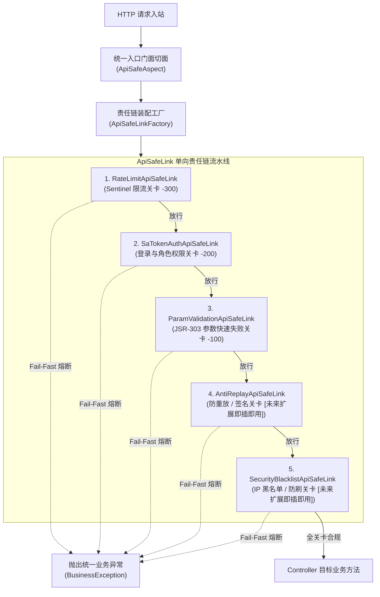
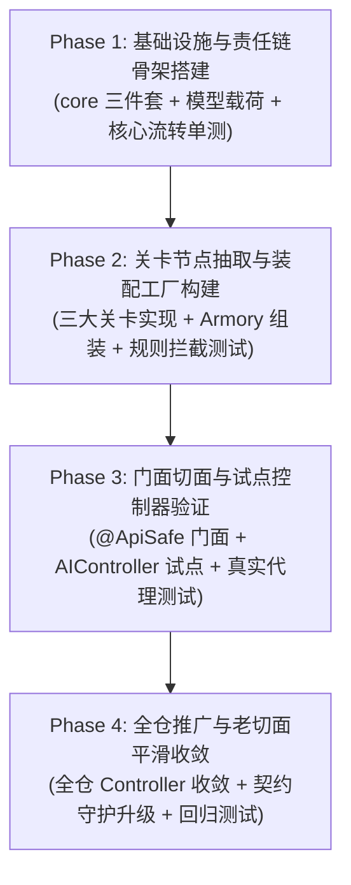

# `ApiSafeLink` 接口安全防护责任链管道重构实施计划

---

## 一、背景与重构动因（Why Change）

### 1. 现状：Controller 注解多重叠加与多层 AOP 代理
目前全仓 50 个核心接口均形成了统一的三级安全拦截体系：
```java
@SentinelRateLimit(resource = "topic.manage.add") // Order = -300 (SentinelRateLimitAspect)
@SaCheckLogin                                     // Order = -200 (Sa-Token 官方切面)
@SaCheckRole(value = {"teacher"}, mode = SaMode.OR)
@ValidateRequest                                  // Order = -100 (RequestDtoValidationAspect)
@PostMapping("/add")
public BaseResponse<Long> addTopic(@RequestBody AddTopicRequest request)
```
- **执行机制**：依赖 Spring AOP 的多层动态代理链，每次请求在 JVM 中依次经历多次切面反射与递归调用（`MethodInvocation.proceed()`）。

### 2. 核心架构痛点
1. **新增通用关卡严重违背开闭原则（OCP）**：
   - 后续如果业务需要新增通用门禁（如：**防重放 Nonce/时间戳签名校验**、**IP 黑白名单/频控拦截**、**敏感词前置过滤**、**接口防刷锁**）；
   - 现有模式下必须新建一个自定义注解和一个 `@Aspect`，并**逐一修改既有 50 个 Controller 方法声明，在上面再叠一层注解**。这直接破坏了对 Controller 的“对扩展开放，对修改关闭”原则。
2. **切面优先级（Order）缺乏集中管控与全局视图**：
   - 依赖散落在各 Aspect 类上的硬编码数值（`@Order(-300)`、`-200`、`-100`），缺乏流水线集中编排机制（Pipeline Definition）。
3. **安全审计与监控可观测性割裂**：
   - 限流、鉴权、校验日志分散在各个组件，缺乏统一的“安全门禁管道耗时统计、放行/拦截计数、熔断断点审计”的上下文容器。

---

## 二、`ApiSafeLink` 架构设计蓝图（To-Be Architecture）

针对上述痛点，构建面向 Controller 入口防护的 **`ApiSafeLink` 单向开闭责任链安全流水线**：



---

## 三、包结构与组件职责划分

在后端工程新建 `cn.edu.nfu.topicselection.manager.safelink` 模块包：

```text
nfu-graduation-topic-selection-backend/src/main/java/cn/edu/nfu/topicselection/manager/safelink/
├── core/
│   ├── IApiSafeChainArmory.java        # 责任链装配工契约 (next, appendNext)
│   ├── IApiSafeLink.java               # 责任链节点接口 (apply)
│   └── AbstractApiSafeLink.java        # 责任链节点抽象基类 (持有 next 引用与 next() 传递)
├── model/
│   ├── ApiSafeParam.java               # 请求静态参数载荷 (joinPoint, method, requestBody, args)
│   └── ApiSafeContext.java             # 动态上下文载荷 (clientIp, loginUser, 耗时统计, attributes)
├── AbstractApiSafeSupport.java         # 统一接口安全防护业务基类 (实现 Ordered, 提供 supports)
├── link/
│   ├── RateLimitApiSafeLink.java       # Sentinel 限流关卡 (Order: -300)
│   ├── SaTokenAuthApiSafeLink.java     # Sa-Token 鉴权关卡 (Order: -200)
│   └── ParamValidationApiSafeLink.java # JSR-303 参数校验关卡 (Order: -100)
├── factory/
│   └── ApiSafeLinkFactory.java         # Spring 自动收集所有 Link -> 排序 -> 串联组装与执行门面
└── aop/
    ├── ApiSafe.java                    # 统一门面注解
    └── ApiSafeAspect.java              # 统一门面切面 (构建上下文并驱动 ApiSafeLinkFactory)
```

---

## 四、核心代码设计示例与骨架（端到端落地参考）

### 1. 责任链通用核心契约（`manager.safelink.core`）

#### 装配工契约：`IApiSafeChainArmory.java`
```java
package cn.edu.nfu.topicselection.manager.safelink.core;

/**
 * 接口安全责任链装配工契约
 *
 * @author wobushi041
 */
public interface IApiSafeChainArmory<T, D, R> {

    /**
     * 获取下游后继节点
     *
     * @return 下一个责任链节点
     */
    IApiSafeLink<T, D, R> next();

    /**
     * 挂载追加下游节点并返回被挂载的后继节点
     *
     * @param next 下一个责任链节点
     * @return 被挂载的后继节点
     */
    IApiSafeLink<T, D, R> appendNext(IApiSafeLink<T, D, R> next);
}
```

#### 节点核心接口：`IApiSafeLink.java`
```java
package cn.edu.nfu.topicselection.manager.safelink.core;

/**
 * 接口安全防护责任链节点接口
 *
 * @author wobushi041
 */
public interface IApiSafeLink<T, D, R> extends IApiSafeChainArmory<T, D, R> {

    /**
     * 执行当前安全关卡校验
     *
     * @param requestParameter 请求静态参数
     * @param dynamicContext   动态上下文载荷
     * @return 关卡执行结果
     * @throws Exception 业务异常或系统异常
     */
    R apply(T requestParameter, D dynamicContext) throws Exception;
}
```

#### 抽象基类：`AbstractApiSafeLink.java`
```java
package cn.edu.nfu.topicselection.manager.safelink.core;

/**
 * 接口安全防护责任链节点抽象基类
 *
 * @author wobushi041
 */
public abstract class AbstractApiSafeLink<T, D, R> implements IApiSafeLink<T, D, R> {

    /**
     * 下游后继安全关卡引用
     */
    private IApiSafeLink<T, D, R> next;

    @Override
    public IApiSafeLink<T, D, R> next() {
        return next;
    }

    @Override
    public IApiSafeLink<T, D, R> appendNext(IApiSafeLink<T, D, R> next) {
        this.next = next;
        return next;
    }

    /**
     * 将请求与上下文传递至下一关卡
     *
     * @param requestParameter 请求静态参数
     * @param dynamicContext   动态上下文载荷
     * @return 下游关卡执行结果
     * @throws Exception 校验不合规时快速失败抛出异常
     */
    protected R next(T requestParameter, D dynamicContext) throws Exception {
        if (next == null) {
            return null;
        }
        return next.apply(requestParameter, dynamicContext);
    }
}
```

---

### 2. 业务层基类与载荷模型（`manager.safelink`）

#### 业务抽象基类：`AbstractApiSafeSupport.java`
```java
package cn.edu.nfu.topicselection.manager.safelink;

import cn.edu.nfu.topicselection.manager.safelink.core.AbstractApiSafeLink;
import cn.edu.nfu.topicselection.manager.safelink.model.ApiSafeContext;
import cn.edu.nfu.topicselection.manager.safelink.model.ApiSafeParam;
import org.springframework.core.Ordered;

/**
 * 统一接口安全防护业务基类
 *
 * @author wobushi041
 */
public abstract class AbstractApiSafeSupport 
        extends AbstractApiSafeLink<ApiSafeParam, ApiSafeContext, Boolean> 
        implements Ordered {

    /**
     * 判断当前关卡是否适用于本次调用的接口
     *
     * @param param 请求静态参数
     * @return 是否适用当前关卡
     */
    public boolean supports(ApiSafeParam param) {
        return true;
    }
}
```

#### 参数与上下文载荷模型：`ApiSafeParam.java` & `ApiSafeContext.java`
```java
package cn.edu.nfu.topicselection.manager.safelink.model;

import lombok.Builder;
import lombok.Data;
import org.aspectj.lang.ProceedingJoinPoint;

import java.lang.reflect.Method;

/**
 * 接口安全校验请求参数载荷
 *
 * @author wobushi041
 */
@Data
@Builder
public class ApiSafeParam {

    /**
     * 当前切点对象
     */
    private ProceedingJoinPoint joinPoint;

    /**
     * 目标方法反射对象
     */
    private Method method;

    /**
     * 目标 Controller 实例
     */
    private Object target;

    /**
     * 请求体反序列化对象（若无 @RequestBody 则为 null）
     */
    private Object requestBody;

    /**
     * 方法入参数组
     */
    private Object[] args;
}
```

```java
package cn.edu.nfu.topicselection.manager.safelink.model;

import cn.edu.nfu.topicselection.model.entity.User;
import lombok.Data;

import java.util.Map;
import java.util.concurrent.ConcurrentHashMap;

/**
 * 接口安全流水线动态上下文
 *
 * @author wobushi041
 */
@Data
public class ApiSafeContext {

    /**
     * 客户端真实 IP
     */
    private String clientIp;

    /**
     * 当前登录用户对象
     */
    private User loginUser;

    /**
     * 跨关卡传递的自定义属性表
     */
    private Map<String, Object> attributes = new ConcurrentHashMap<>();
}
```

---

### 3. 具体安全关卡实现（以参数校验与未来防重放关卡为例）

#### 参数校验关卡：`ParamValidationApiSafeLink.java`（Order = -100）
```java
package cn.edu.nfu.topicselection.manager.safelink.link;

import cn.edu.nfu.topicselection.exception.BusinessException;
import cn.edu.nfu.topicselection.exception.CodeBindMessageEnums;
import cn.edu.nfu.topicselection.manager.safelink.AbstractApiSafeSupport;
import cn.edu.nfu.topicselection.manager.safelink.model.ApiSafeContext;
import cn.edu.nfu.topicselection.manager.safelink.model.ApiSafeParam;
import org.springframework.stereotype.Component;

import javax.annotation.Resource;
import javax.validation.ConstraintViolation;
import javax.validation.Validator;
import java.util.Comparator;
import java.util.Set;

/**
 * JSR-303 请求体参数快速失败校验关卡
 *
 * @author wobushi041
 */
@Component
public class ParamValidationApiSafeLink extends AbstractApiSafeSupport {

    /**
     * 注入 JSR-303 校验器实例
     */
    @Resource
    private Validator validator;

    @Override
    public int getOrder() {
        return -100; // 管道末关：参数校验
    }

    @Override
    public boolean supports(ApiSafeParam param) {
        return param.getRequestBody() != null;
    }

    @Override
    public Boolean apply(ApiSafeParam param, ApiSafeContext context) throws Exception {
        Object body = param.getRequestBody();

        // 请求体判空快速失败
        if (body == null) {
            throw new BusinessException(CodeBindMessageEnums.PARAMS_ERROR, "请求体不能为空");
        }

        // 执行 JSR-303 契约约束校验
        Set<ConstraintViolation<Object>> violations = validator.validate(body);
        if (!violations.isEmpty()) {
            ConstraintViolation<Object> firstViolation = violations.stream()
                    .min(Comparator.comparing(v -> v.getPropertyPath().toString()))
                    .orElse(violations.iterator().next());
            throw new BusinessException(CodeBindMessageEnums.PARAMS_ERROR, firstViolation.getMessage());
        }

        // 当前关卡合规放行，传递给下一个节点
        return next(param, context);
    }
}
```

#### 未来新增关卡示例：`AntiReplayApiSafeLink.java`（展现开闭原则 OCP 即插即用）
> **无需改动既有 Controller 任何一行代码**，只需新建此类并注入 Spring，全仓自动生效：
```java
package cn.edu.nfu.topicselection.manager.safelink.link;

import cn.edu.nfu.topicselection.manager.safelink.AbstractApiSafeSupport;
import cn.edu.nfu.topicselection.manager.safelink.model.ApiSafeContext;
import cn.edu.nfu.topicselection.manager.safelink.model.ApiSafeParam;
import org.springframework.stereotype.Component;

/**
 * 防重放时间戳与签名校验关卡（未来扩展关卡）
 *
 * @author wobushi041
 */
@Component
public class AntiReplayApiSafeLink extends AbstractApiSafeSupport {

    @Override
    public int getOrder() {
        return -250; // 插入限流(-300)之后、鉴权(-200)之前
    }

    @Override
    public Boolean apply(ApiSafeParam param, ApiSafeContext context) throws Exception {
        // 执行防重放校验，违规抛出异常终止
        // 合规放行
        return next(param, context);
    }
}
```

---

### 4. 责任链自动装配工厂（`ApiSafeLinkFactory.java`）

```java
package cn.edu.nfu.topicselection.manager.safelink.factory;

import cn.edu.nfu.topicselection.manager.safelink.AbstractApiSafeSupport;
import cn.edu.nfu.topicselection.manager.safelink.core.IApiSafeLink;
import cn.edu.nfu.topicselection.manager.safelink.model.ApiSafeContext;
import cn.edu.nfu.topicselection.manager.safelink.model.ApiSafeParam;
import lombok.extern.slf4j.Slf4j;
import org.springframework.core.Ordered;
import org.springframework.stereotype.Component;

import java.util.Comparator;
import java.util.List;

/**
 * 接口安全责任链自动装配工厂与执行门面
 *
 * @author wobushi041
 */
@Component
@Slf4j
public class ApiSafeLinkFactory {

    /**
     * 责任链头节点引用
     */
    private final IApiSafeLink<ApiSafeParam, ApiSafeContext, Boolean> headLink;

    /**
     * 构造责任链装配工厂并自动串联全仓安全关卡节点
     *
     * @param links Spring 自动收集的全量 AbstractApiSafeSupport 关卡实例
     */
    public ApiSafeLinkFactory(List<AbstractApiSafeSupport> links) {
        if (links == null || links.isEmpty()) {
            this.headLink = null;
            return;
        }

        // 1. 按 Ordered 升序排序：RateLimit(-300) -> AntiReplay(-250) -> Auth(-200) -> Validation(-100)
        links.sort(Comparator.comparingInt(Ordered::getOrder));

        // 2. 循环将节点串联为单向责任链表
        for (int i = 0; i < links.size() - 1; i++) {
            links.get(i).appendNext(links.get(i + 1));
        }

        // 3. 锁定责任链头节点
        this.headLink = links.get(0);
        log.info("ApiSafeLink 责任链装配完成，流水线关卡总数：{}", links.size());
    }

    /**
     * 启动接口安全责任链流水线检查
     *
     * @param param   请求参数载荷
     * @param context 动态上下文载荷
     * @throws Exception 任一关卡违规时立即快速失败抛出异常
     */
    public void execute(ApiSafeParam param, ApiSafeContext context) throws Exception {
        if (headLink != null) {
            headLink.apply(param, context);
        }
    }
}
```

---

### 5. 统一门面切面与 Controller 最终形态

#### 统一切面：`ApiSafeAspect.java`
```java
package cn.edu.nfu.topicselection.aop;

import cn.edu.nfu.topicselection.annotation.ApiSafe;
import cn.edu.nfu.topicselection.manager.safelink.factory.ApiSafeLinkFactory;
import cn.edu.nfu.topicselection.manager.safelink.model.ApiSafeContext;
import cn.edu.nfu.topicselection.manager.safelink.model.ApiSafeParam;
import org.aspectj.lang.ProceedingJoinPoint;
import org.aspectj.lang.annotation.Around;
import org.aspectj.lang.annotation.Aspect;
import org.springframework.core.annotation.Order;
import org.springframework.stereotype.Component;

import javax.annotation.Resource;

/**
 * 统一接口安全防护责任链门面切面
 *
 * @author wobushi041
 */
@Aspect
@Component
@Order(-500) // 门面切面位于最外层，统一调度责任链流水线
public class ApiSafeAspect {

    @Resource
    private ApiSafeLinkFactory apiSafeLinkFactory;

    @Around("@annotation(apiSafe)")
    public Object around(ProceedingJoinPoint joinPoint, ApiSafe apiSafe) throws Throwable {
        // 1. 构建参数载荷与执行上下文
        ApiSafeParam param = buildParam(joinPoint);
        ApiSafeContext context = buildContext(joinPoint);

        // 2. 责任链单向流转并快速失败（违规即在相应关卡抛出异常中断）
        apiSafeLinkFactory.execute(param, context);

        // 3. 全关卡放行，执行目标业务方法
        return joinPoint.proceed();
    }
}
```

#### Controller 形态对比

- **重构前（多重注解叠加）**：
  ```java
  @SentinelRateLimit(resource = "topic.manage.add")
  @SaCheckLogin
  @SaCheckRole(value = {"teacher"}, mode = SaMode.OR)
  @ValidateRequest
  @PostMapping("/add")
  public BaseResponse<Long> addTopic(@RequestBody AddTopicRequest request)
  ```

- **重构后（单一门面注解，所有关卡由 `ApiSafeLink` 管道自动管控）**：
  ```java
  @ApiSafe(resource = "topic.manage.add", roles = "teacher")
  @PostMapping("/add")
  public BaseResponse<Long> addTopic(@RequestBody AddTopicRequest request)
  ```

---

## 五、分阶段推进路线图（4 个阶段）



---

### Phase 1：基础设施与责任链骨架搭建
- **目标**：落地通用链路接口，确保纯责任链机制在无 Spring 环境下具备高内聚、轻量装配与严格的向下传递/熔断能力。
- **任务清单**：
  1. 创建 `IApiSafeChainArmory.java`：定义 `next()` 与 `appendNext(...)`；
  2. 创建 `IApiSafeLink.java`：继承装配接口，定义 `R apply(T param, D context)`；
  3. 创建 `AbstractApiSafeLink.java`：持有 `next`，封装 `next(param, context)`；
  4. 创建 `ApiSafeParam.java` 与 `ApiSafeContext.java` 载荷模型（严格遵循 3 行 Javadoc 与规范）；
  5. 创建 `AbstractApiSafeSupport.java`：绑定泛型入参与 `Ordered` 排序契约；
  6. 编写单元测试 `ApiSafeLinkCoreTest.java`：
     - 测试链表构造与 `appendNext` 链式串联正确性；
     - 测试正常流转逐级放行；
     - 测试中间节点抛出异常时快速熔断（下游节点 100% 不被执行）。
- **验证手段**：运行 `verify-style.ps1` 确保规范 0 违规，单测 100% 绿色通过。

---

### Phase 2：三大关卡节点抽取与装配工厂构建
- **目标**：将既有的 Sentinel 限流、Sa-Token 鉴权与 JSR-303 参数校验无损抽离为可插拔的 `ApiSafeLink` 节点，并通过工厂实现 Spring 容器级别的自动装配。
- **任务清单**：
  1. 实现 `RateLimitApiSafeLink`（Order = -300）：
     - 检查方法上的 `@SentinelRateLimit` 注解（或预置资源名规则），调用 `SphU.entry`，触发限流抛出 `FLOW_LIMITING`；
  2. 实现 `SaTokenAuthApiSafeLink`（Order = -200）：
     - 检查方法或类上的 `@SaCheckLogin`、`@SaCheckRole`、`@SaCheckPermission`，委托 `StpUtil` 进行校验；
  3. 实现 `ParamValidationApiSafeLink`（Order = -100）：
     - 检查入参中的 `@RequestBody` 对象，通过 JSR-303 `Validator` 进行 Fail-Fast 校验；
  4. 实现 `ApiSafeLinkFactory`：
     - 构造器自动注入 `List<AbstractApiSafeSupport>`；
     - 按 `getOrder` 升序排序，循环执行 `links.get(i).appendNext(links.get(i + 1))`；
     - 暴露 `execute(ApiSafeParam param, ApiSafeContext context)` 统一流水线门面；
  5. 编写集成测试 `ApiSafeLinkFactoryTest.java`：
     - 测试限流未通过时快速熔断（不进入鉴权与参数校验）；
     - 测试鉴权未通过时快速熔断（不进入参数校验）；
     - 测试全部合规时完整放行。
- **验证手段**：运行 `mvnw.cmd test -Dtest=ApiSafeLinkFactoryTest`。

---

### Phase 3：门面切面接入与试点控制器验证
- **目标**：引入单一门面注解 `@ApiSafe`，在不破坏现有接口行为的前提下，在试点控制器上验证责任链全链路流通。
- **任务清单**：
  1. 定义门面注解 `@ApiSafe`：
     - 允许自定义资源名、免除特定关卡等可插拔属性；
  2. 实现统一切面 `ApiSafeAspect`：
     - 组装 `ApiSafeParam`（提取当前 JoinPoint、Method、Args 与 RequestBody）；
     - 组装 `ApiSafeContext`（提取当前客户端 IP、Sa-Token 登录用户等）；
     - 调用 `apiSafeLinkFactory.execute(param, context)`；
     - 放行调用 `joinPoint.proceed()`；
  3. 试点验证：
     - 在 `AIController`（包含 1 个接口）中挂载 `@ApiSafe` 进行全功能试点；
     - 在 `ControllerValidationInstanceTest` 中增加针对 `@ApiSafe` 的代理实例端到端测试，验证 Fail-Fast 行为。
- **验证手段**：验证试点接口真实表现与已有单测契约 100% 保持兼容。

---

### Phase 4：全仓推广、契约升级与平滑收敛
- **目标**：将 `ApiSafeLink` 责任链推广至全仓其余 Controller，收敛冗余 AOP 注解，完成开闭原则重构闭环。
- **任务清单**：
  1. 分模块推进 Controller 接入 `@ApiSafe` 门面注解；
  2. 升级各 Controller 对应的 `*ContractTest` 契约守护（断言方法标注了 `@ApiSafe`，禁止直接堆叠散落切面）；
  3. 更新 `TODO.md`，将“接口横切关卡重构为单向开闭、快速失败的责任链管道”标记为已完成；
  4. 全量回归测试：
     - 执行 `.\mvnw.cmd test`；
     - 执行 `pwsh verify-style.ps1`。
- **验证手段**：全仓单元测试与契约测试 100% 通过，Java 编码规范 0 违规。

---

## 六、重构风险控制与兼容性保障

1. **错误文案与响应格式 100% 保持一致**：
   - 各个 `ApiSafeLink` 节点抛出的异常必须与当前各切面抛出的 `CodeBindMessageEnums` 和具体错误文字 100% 逐字对应，确保前端与契约测试完全无感。
2. **渐进式平滑过渡（双轨兼容）**：
   - 在新切面和工厂落地期间，既有的 `SentinelRateLimitAspect` 和 `RequestDtoValidationAspect` 保持平稳，直到 Phase 4 全仓切换完成并经过全量回归测试后再平滑退役，杜绝系统性回归风险。
3. **保留业务 Service 事务边界**：
   - 责任链仅处理 Web 横切关卡（HTTP 协议解析后、Controller 执行前），完全不侵入任何 Service 事务生命周期。
